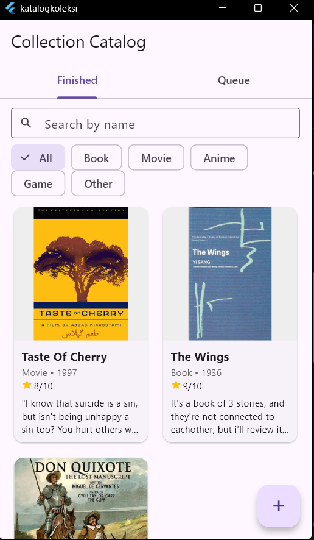
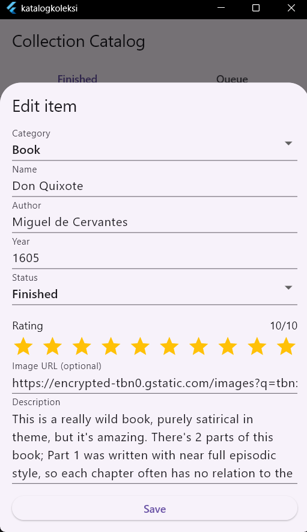
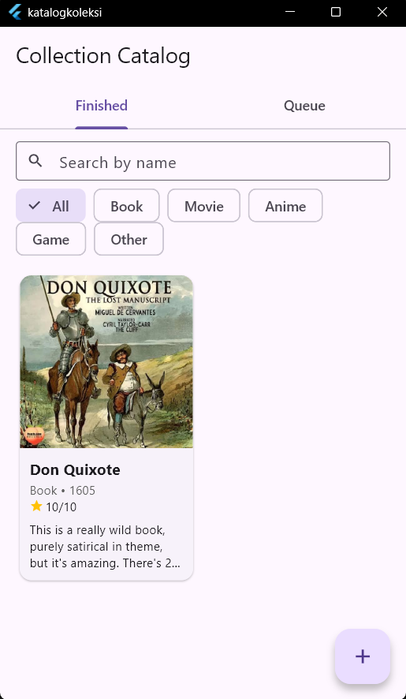
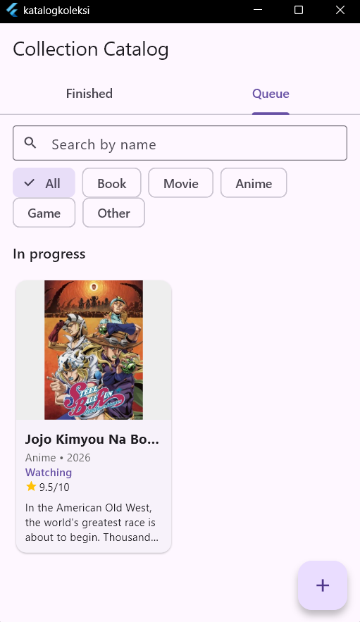
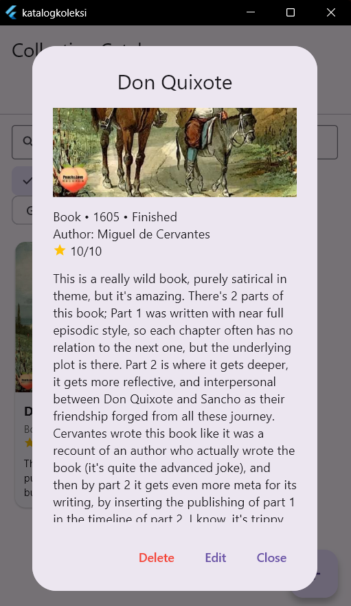
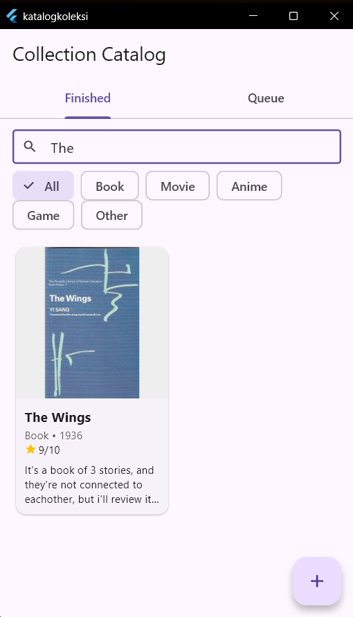

# Katalog Koleksi (Collection Catalog)

Aplikasi desktop (Windows) untuk mencatat koleksi buku, film, anime, game, dan koleksi lain beserta statusnya (sudah selesai, sedang berjalan, atau belum dimulai), rating, dan deskripsi. Dibuat dengan **Flutter** dan **SQLite** sebagai tugas UTS Mobile Dev II.

Tampilan aplikasi berbahasa Inggris, sedangkan seluruh dokumentasi ditulis dalam bahasa Indonesia.

## Fitur

- Dimulai dalam keadaan kosong, semua data ditambahkan sendiri lewat tombol plus
- Lima kategori tetap: Book, Movie, Anime, Game, dan Other
- Tiga status: **Finished**, sedang berjalan (Reading / Watching / Playing, menyesuaikan kategori), dan **Not yet**
- Halaman depan menampilkan item Finished, tab Queue berisi item yang sedang berjalan dan yang belum dimulai
- Kartu dengan gambar thumbnail dan potongan deskripsi
- Form tambah data: Name, Year, Author/Director/Studio, Rating (bintang, bisa setengah), Image URL, dan Description
- Lihat detail, ubah, dan hapus (hapus dengan konfirmasi)
- Pencarian berdasarkan nama dan filter berdasarkan kategori
- Data tersimpan di SQLite lokal

## Tangkapan layar

| Kondisi awal (kosong) | Form tambah data |
|---|---|
|  |  |

| Tab Finished | Tab Queue |
|---|---|
|  |  |

| Dialog detail | Pencarian dan filter |
|---|---|
|  |  |

## Teknologi

- Flutter (target Windows desktop)
- SQLite lewat `sqflite` dan `sqflite_common_ffi`
- `path`

## Struktur project

```
lib/
|-- main.dart                    inisialisasi database dan aplikasi
|-- models/item.dart             model data Item
|-- helper/database_helper.dart  akses SQLite (CRUD)
`-- pages/home_screen.dart       halaman utama, form, dan dialog
```

## Struktur database

Satu tabel `items`:

| Kolom | Tipe | Keterangan |
|---|---|---|
| id | INTEGER | primary key, autoincrement |
| category | TEXT | `book`, `movie`, `anime`, `game`, atau `other` |
| title | TEXT | nama, wajib |
| creator | TEXT | penulis, sutradara, studio, developer, atau pembuat |
| year | INTEGER | tahun rilis |
| status | TEXT | `finished`, `ongoing`, atau `not_yet` |
| rating | REAL | 0,5 sampai 10 dengan kelipatan 0,5 |
| description | TEXT | deskripsi |
| image_url | TEXT | alamat gambar thumbnail |

## Menjalankan aplikasi

Aplikasi dijalankan pada target Windows. Chrome tidak bisa dipakai karena `sqflite` dan `dart:io` tidak berjalan di browser.

```
flutter pub get
flutter run -d windows
```

Data tersimpan di file database lokal pada komputer, dan database dibuat otomatis saat aplikasi pertama kali dijalankan.

## Dokumentasi pembuatan

Proses pembuatan dicatat per fase di folder [`docs/`](docs/):

| Fase | Dokumen |
|---|---|
| 0 | [Perencanaan](docs/01-perencanaan.md) |
| 1 | [Setup project](docs/02-setup-project.md) |
| 2 | [Database](docs/03-database.md) |
| 3 | [Tampilan utama dan tambah data](docs/04-tampilan-dan-tambah.md) |
| 4 | [Detail, ubah, dan hapus](docs/05-detail-ubah-hapus.md) |
| 5 | [Pencarian dan filter](docs/06-cari-filter.md) |
| 6 | [Polish dan pengujian](docs/07-polish.md) |

Setiap fase dikirim ke repositori sebagai satu commit.
